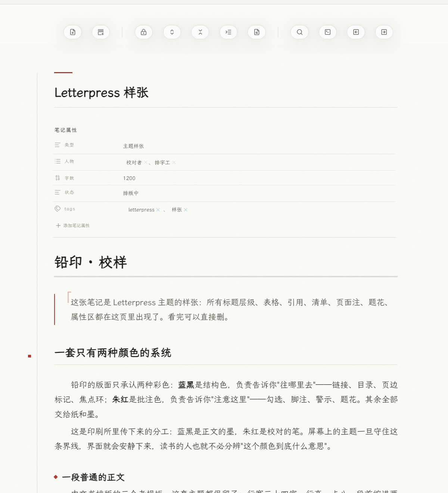
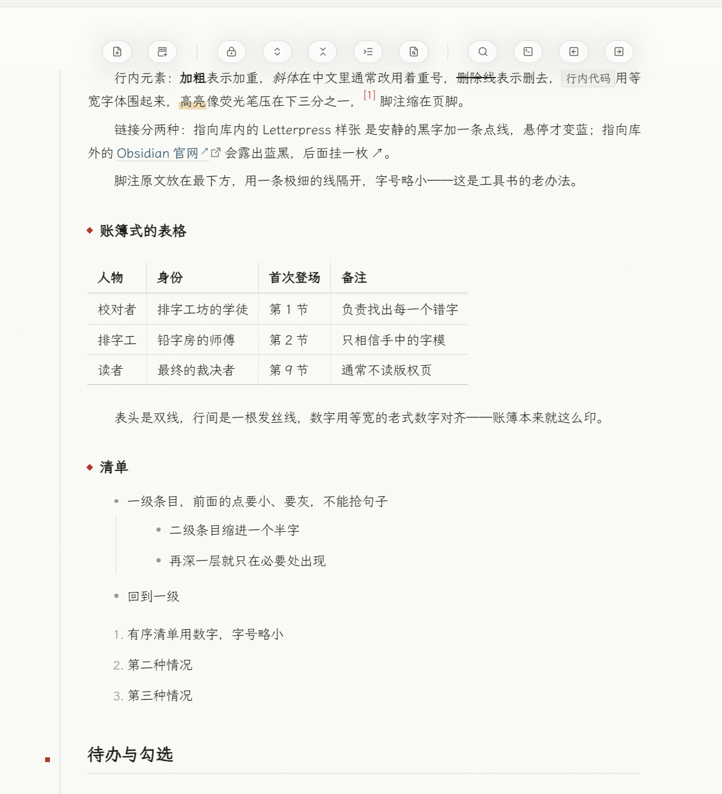
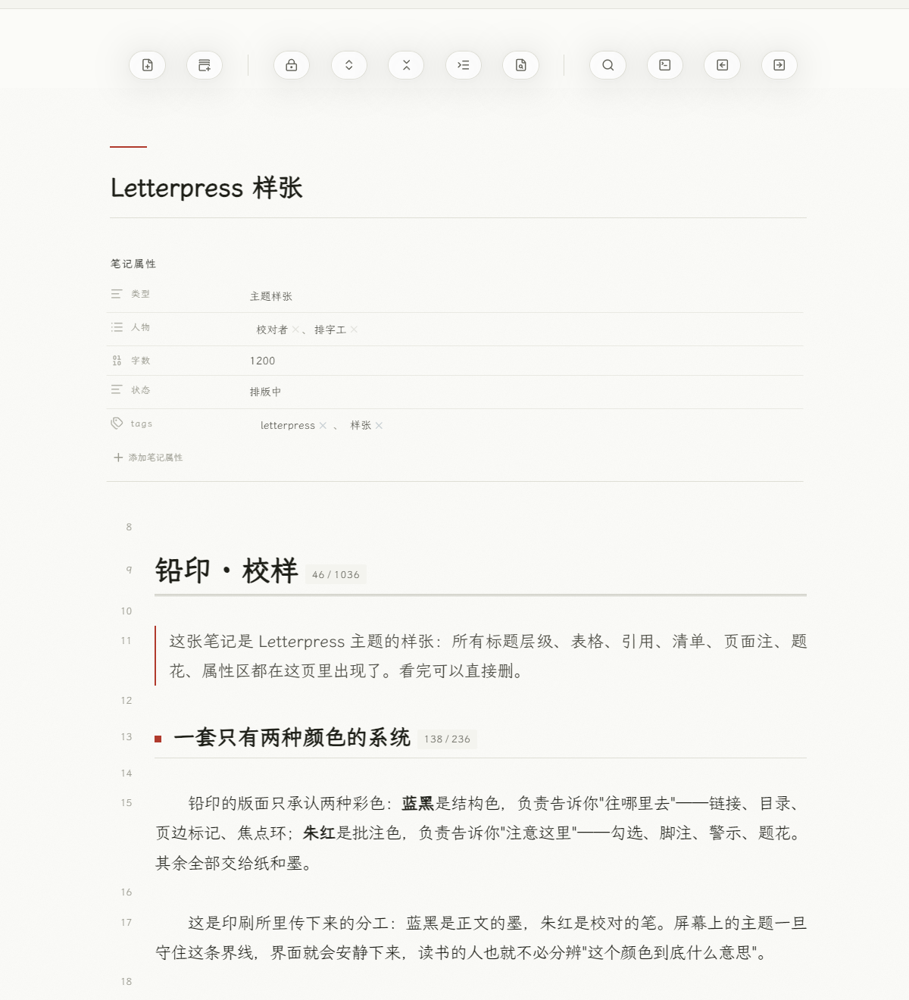

# Letterpress · 铅印

一张正在被批注的校样。

为中文长文阅读而写的 Obsidian 主题：暖中性灰的纸、近黑的墨、宽度一律 1px 的发丝线，以及**只有两种彩色**的一套语义。



> An editorial theme for Obsidian: warm paper, ink, hairline rules, and exactly two accents — ink-blue for structure, vermilion for annotations. Built around Chinese long-form typography (2-character first-line indent, 34-character measure, hanging punctuation ornaments).

## 两种颜色，各管一件事

| 颜色 | 含义 | 出现的地方 |
| --- | --- | --- |
| 蓝黑 `#2e4f66` | 结构色：「往哪里去」 | 链接、目录高亮、焦点环、主按钮 |
| 朱红 `#b03a2c` | 批注色：「注意这里」 | 勾选、脚注、题花、警示类页面注、命令面板选中项 |

其余全是纸和墨。没有圆角卡片、没有阴影堆叠、没有第三种彩色。

## 版面

- **行宽 34 字、行高 1.8、段首缩进 2 字、两端对齐**。阅读视图和实时预览都有——实时预览里一个段落就是一个 `.cm-line`，软换行只是视觉折行，所以 `text-indent` 只缩段首那一行。
- **标题层级靠「线 + 记号」**：H1 双线收底，H2 单线加一枚朱红方块，H3 一枚菱形，H4–H6 只靠字距和灰度。线都挂在标题下面，不会让人误读成上一段的结束线。
- **表格是账簿**：双线表头、竖发丝线、等宽老式数字、无斑马纹。
- **分隔线**是一根发丝线上压一枚菱形题花（用背景层画的，不依赖字体字形）。
- **页面注（callout）不填色**：只有左侧一条 2px 语义色细线和一枚加字距的小标签，像纸书页边的批注。另附 `[!scene]`、`[!author]` 两个自定义类型。
- **属性区当表单**：键名小、淡、带字距；值用正文色。
- **纸纹**：一层 5.5% 的噪点，只铺在正文页上，不碰侧栏和菜单。



## 实时预览

主题以编辑器为主要场景，不是"阅读模式的附属"：



段首缩进、两端对齐、标题记号、账簿表格、朱红复选框、题花、页面注在编辑模式里同样生效；只有左侧那条「版心线」是阅读视图专属。

## 安装

手动安装：

1. 下载或克隆本仓库；
2. 把 `theme.css`、`manifest.json` 放进 `<你的库>/.obsidian/themes/Letterpress/`；
3. 打开 Obsidian → 设置 → 外观 → 主题 → 选 **Letterpress**。

## 样式设置（可选）

装了 [Style Settings](https://github.com/mgmeyers/obsidian-style-settings) 之后可以调：

- 行宽：窄 30 字 / 宽 42 字 / 标准 34 字
- 段落改为段间留白（仅阅读模式生效）
- 隐藏左侧版心线
- 关闭纸纹
- 侧栏字号（文件树 / 大纲 / 搜索，默认 15px）
- 全直角

不装插件时主题按默认值工作——所有开关都是「用类名关掉某个默认行为」，不是「用类名才能启用」。

想改颜色，写个 snippet 覆盖两个变量即可：

```css
body.theme-light { --lp-ink-blue: #2e4f66; --lp-vermilion: #b03a2c; }
body.theme-dark  { --lp-ink-blue: #8fb6cb; --lp-vermilion: #e0796a; }
```

## 已知取舍

- **不做章节自动编号**。阅读视图按段挂载/卸载 DOM，CSS 计数器在长文里会从中间重新数起（实测从第 3 节跳回第 1 节）。编号错比没编号更糟，所以 H2 用一枚不带数字的方块做标记。
- **mermaid 节点配色改不动**。新版 mermaid 把 `fill`/`stroke` 写成行内 `style="… !important"`，任何样式表都覆盖不了；想改只能写在图的 `classDef` / `style` 里。本主题只负责把图表内的字号、行高、缩进隔离干净（否则会撑破 mermaid 自己算好的节点框），并去掉会让 SVG 发虚的整图滤镜。
- 段首缩进在实时预览里只作用于「纯段落行」；标题、清单、引用、代码、表格、callout 那些行不缩进。

## 字体

主题不内置字体，也不覆盖你的字体设置，字号层级全部用 `em`，所以改字号时整条标题阶梯等比缩放。

在意观感的话：正文衬线（思源宋体 / Noto Serif CJK SC / 霞鹜文楷都可以），界面无衬线，代码等宽。

## 许可

[MIT](LICENSE)
